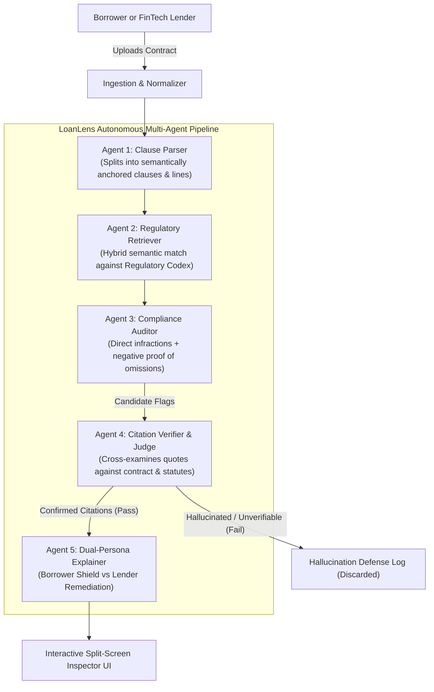

# LoanLens: Agentic Regulatory Compliance Engine for Digital Lending..

[](https://www.rbi.org.in)
[]()
[]() 

> **Hackathon Submission Demo**  
> **Problem:** Millions of first-time borrowers accept digital loans by tapping *"I Agree"* on 15–20 pages of dense legal text they cannot evaluate. Predatory terms (contact harvesting, hidden APR, third-party repayments, recovery harassment) hide inside.  
> **Solution:** **LoanLens** is an agentic compliance checker that decomposes agreements into clauses, retrieves relevant regulatory rules, flags violations and missing disclosures with exact citations, and uses an autonomous verification step to reject unconfirmed or hallucinated claims.

---

## 1. System Architecture & Agent Workflow



### The 5 Agent Roles

| Agent | Responsibility | Key Innovation |
|---|---|---|
| **1. Clause Parser Agent** | Splits dense legal PDF/text into indexed clauses (`clause_1`, `clause_2`) preserving line ranges and section headers. | Prevents loss of cross-clause context. |
| **2. Regulatory Retriever Agent** | Queries official digital lending directives (e.g. RBI Digital Lending Directives 2022 / Fair Lending Codex). | Fetches exact paragraph numbers of the law. |
| **3. Compliance Auditor Agent** | Tests for **Direct Violations** (e.g., forced contact access) and **Omission Violations** (e.g., missing KFS, missing 3-day cooling-off window). | Checks both explicit terms and what is dangerously omitted. |
| **4. Citation Verifier & Judge Agent** | **The Key Differentiator**: Verifies that the quoted text exists verbatim in the uploaded document and that the legal rule cited strictly forbids it. If the citation is loose or hallucinated, it is **rejected**. | Eliminates false legal accusations and hallucinations. |
| **5. Dual-Persona Explainer Agent** | Generates two distinct perspectives: <br>• **Borrower Mode**: 8th-grade reading level plain English warnings.<br>• **Lender Mode**: Exact remediation amendment drafts for compliance officers. | Bridges the gap between consumer safety and B2B SaaS. |

---

## 2. Regulatory Codex Embedded

Based on the benchmark **RBI Guidelines on Digital Lending (2022)**:
- **RBI-DL-01**: Strict prohibition on accessing mobile contacts, photo galleries, call logs, and device storage.
- **RBI-DL-02**: Mandatory Key Fact Statement (KFS) and annualized APR disclosure (all-inclusive cost).
- **RBI-DL-03**: Direct bank account-to-bank account disbursal and repayments (no 3rd party pool/UPI accounts).
- **RBI-DL-04**: Mandatory 3-day cooling-off / look-up exit period without penalty.
- **RBI-DL-05**: Prominent disclosure of Nodal Grievance Redressal Officer (name, phone, TAT, RBI Ombudsman link).
- **RBI-DL-06**: Prohibition on intimidation, harassment, and contacting third parties/employers.
- **RBI-DL-07**: Ban on automatic/unilateral credit limit enhancements without prior affirmative consent.

---

## 3. Technology Stack

- **Frontend:**
  - Modern Single Page Application (HTML5 / Tailwind CSS / Modern ES6).
  - Split-screen synced reader: clicking any violation card scrolls and highlights the exact clause in the contract.
  - Borrower vs Lender persona toggle.
  - Verifier Inspector tab showing confirmed citations vs rejected hallucinations.
  - One-click export of the formal Audit Report.
- **Backend & APIs:**
  - Python HTTP Server (`server.py`) exposing REST APIs:
    - `POST /api/analyze` — Runs the full multi-agent pipeline on custom text.
    - `GET /api/presets` — Pre-loaded loan agreements for instant live demos.
    - `GET /api/rules` — Returns the certified regulatory knowledge base.
- **Agent Orchestrator:**
  - `core/orchestrator.py` — Coordinates Parser, Retriever, Auditor, and Verifier agents.
  - Zero-dependency client-side fallback: The demo can also run completely offline by opening `index.html` in any browser!

---

## 4. How to Run the Demo

### Option 1: One-Click Launcher (Windows)
Double-click `run_demo.bat`. It will start the local server and open `http://localhost:8080` in your default browser.

### Option 2: Command Line
```powershell
python server.py
```
Then visit: **`http://localhost:8080`**

### Option 3: Zero-Install Standalone
Simply double-click `index.html` in file explorer. The built-in client orchestrator runs directly in your browser!

---

## 5. Demo Presets Included for Judging

1. 🔴 **Predatory QuickRupee Instant Cash (Score: 0/100)**:
   - Contains blatant contact harvesting, photo gallery access, 1.25% daily rate (450%+ APR), 3rd party recovery payments, cooling-off waiver, and employer harassment clauses.
2. 🟡 **Borderline FinTech Credit Line (Score: 35/100)**:
   - Hidden APR calculation, automatic credit limit increase, and missing Nodal Grievance Officer details.
3. 🟢 **Compliant Bank KFS (Score: 100/100)**:
   - Standard RBI-compliant Key Fact Statement with explicit zero phone access policy, direct banking channels, 3-day cooling-off period, and published Nodal Officer escalation path.
